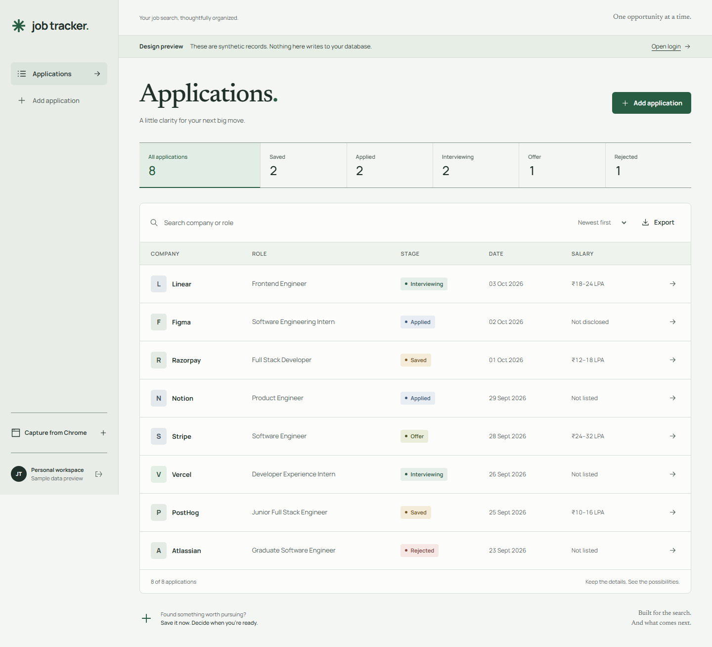
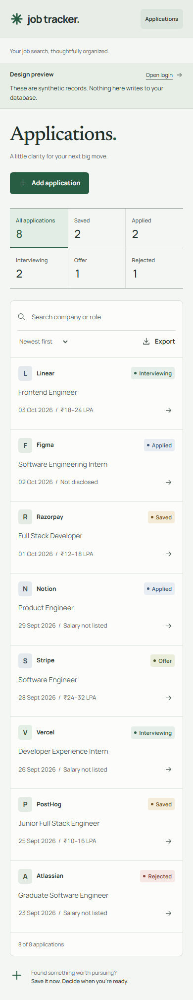
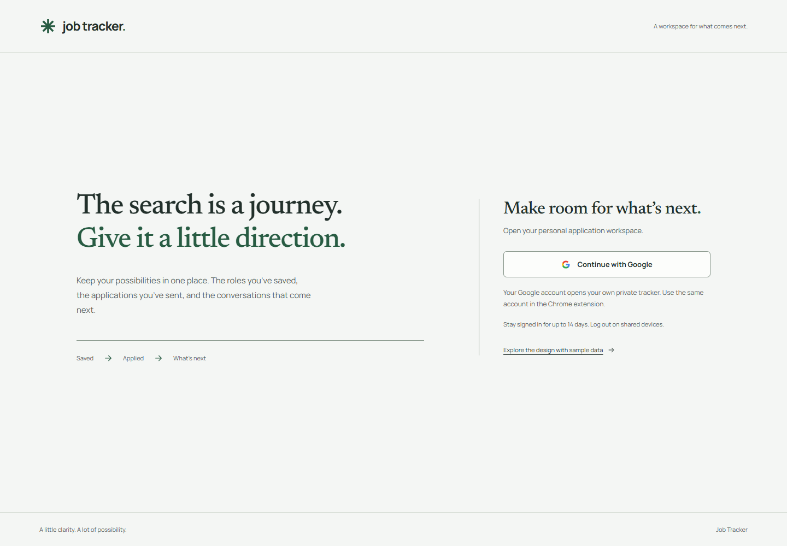
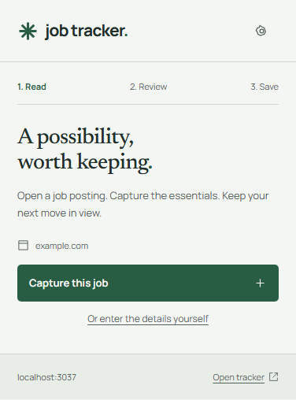
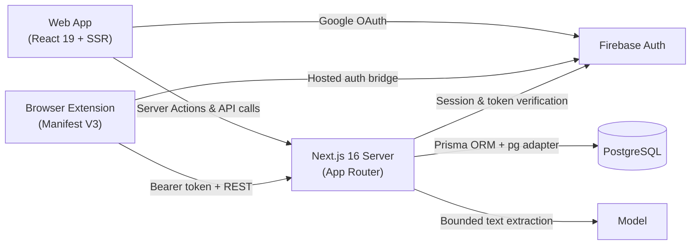

<div align="center">


# Job Tracker

**Stop retyping job postings. Capture them from Browser, let AI do the data entry, and track every application in your own private dashboard.**

<p>
  
  
  
  
  
  
  
</p>

A full-stack application tracking platform, server-rendered Next.js 16 dashboard on one end, a Manifest V3 Browser extension on the other, with Gemini-powered NLP extraction bridging the two. Unified identity via Firebase. Per-user data isolation via PostgreSQL row-level scoping. Zero shared state between accounts.

[Architecture](#architecture) · [Features](#features) · [Security Model](#security-model) · [Getting Started](#getting-started) · [Testing](#testing) · [Deployment](#deployment)

</div>

---

## The Problem

Every job tracker out there wants you to manually copy-paste company names, roles, salary ranges, and URLs from the posting you're literally staring at. Some of them dump you into a shared workspace with other people's applications. Others lock basic features behind a paywall.

Job Tracker takes a different approach. You're already on the job listing page, so the extension reads it for you, pipes the text through Gemini for structured field extraction, and hands you a pre-filled draft to review. One click to save. The record shows up in your dashboard, scoped entirely to your Google account. Nobody else can see it, touch it, or even know it exists.

If you don't want AI involved, that's fine too. Type the fields yourself. The tracker doesn't care how the data gets in, it just makes sure it's validated, stored, and only accessible to you.

## Preview

| Application Dashboard                                            | Mobile Layout                                            |
| ---------------------------------------------------------------- | -------------------------------------------------------- |
|  |  |

| Google Sign-In                           | Browser Extension                                          |
| ---------------------------------------- | ---------------------------------------------------------- |
|  |  |

> Screenshots show sample data. When setting up, point the extension at your own tracker origin.

---

## Architecture

The system is split into three layers: **client** (web app + extension), **server** (Next.js API layer + SSR), and **services** (PostgreSQL, Firebase Auth, Gemini). No client ever talks directly to the database or to Gemini, everything is mediated through authenticated server-side routes.



### Data Flow

```
┌─────────────┐    innerText     ┌─────────────┐   verified token   ┌──────────────┐
│  Job Listing │ ──────────────► │  Extension   │ ─────────────────► │  /api/extract │
│   (Browser)   │                 │  (popup.ts)  │                    │  (server)     │
└─────────────┘                  └──────┬───────┘                    └──────┬────────┘
                                        │                                   │
                                        │ draft review                      │ Gemini API
                                        ▼                                   ▼
                                 ┌──────────────┐   POST validated   ┌──────────────┐
                                 │  User Review  │ ────────────────► │  /api/apps    │
                                 │  & Approval   │                   │  (Prisma)     │
                                 └──────────────┘                    └──────┬────────┘
                                                                           │
                                                                           ▼
                                                                    ┌──────────────┐
                                                                    │  PostgreSQL   │
                                                                    │  (per-user)   │
                                                                    └──────────────┘
```

### How the Pieces Talk

| Component | Talks to       | Mechanism                                                        |
| --------- | -------------- | ---------------------------------------------------------------- |
| Web app   | Next.js server | Server-rendered pages, server actions, fetch calls               |
| Extension | Next.js server | REST API with Firebase bearer token in `Authorization` header    |
| Web app   | Firebase Auth  | Client-side Google OAuth popup → ID token exchange               |
| Extension | Firebase Auth  | Offscreen document → hosted bridge → auth state relay            |
| Server    | Firebase Admin | `verifySessionCookie()` for web, `verifyIdToken()` for extension |
| Server    | PostgreSQL     | Prisma Client with `@prisma/adapter-pg` driver adapter           |
| Server    | Gemini         | `@google/genai` SDK, `gemini-2.0-flash`, JSON-mode extraction    |

### Why This Split

- **Firebase handles identity, not storage.** It answers "who is this person?" PostgreSQL answers "what did they apply to?"
- **Gemini handles extraction, not persistence.** It receives bounded text, returns structured JSON. It never touches the database.
- **Credentials are server-only.** The Firebase Admin key, database connection string, and Gemini API key never ship to the client or the extension. The extension gets public Firebase config from a dedicated endpoint.

---

## Features

### Dashboard — Web Application

- **Server-side rendered pipeline view.** Applications flow through five discrete stages, `SAVED → APPLIED → INTERVIEWING → OFFER → ACCEPTED/REJECTED`, with instant stage transitions via inline controls.
- **Full-text search with debounced input.** Filter applications by company name or role title. Queries hit the database with Prisma `contains` filters, no client-side search over stale data.
- **Multi-axis sorting.** Sort by application date or company name, ascending or descending. Sort state persists across filter changes.
- **Stage-based faceted filtering.** Drill into any pipeline stage with a single click. Active filters are visually indicated and clearable.
- **Paginated result sets.** Large application lists don't choke the browser. Server-driven pagination with configurable page size.
- **Validated CRUD operations.** Every create and update runs through a shared validation layer, required fields, character limits, URL scheme enforcement, date parsing — before the query touches Prisma.
- **Inline editing with optimistic UI.** Edit any field without a page reload. Stage changes, company edits, notes, all update in place.
- **Destructive action safeguards.** Delete triggers a confirmation dialog. No accidental data loss from a misclick.
- **CSV export with active filter passthrough.** The export endpoint respects your current search query and stage filter. What you see is what you download.
- **Responsive layout with breakpoint-driven views.** Desktop renders a full data table with sortable column headers. Mobile collapses into scannable cards with the same data, just reorganized for thumb-friendly interaction.
- **Accessibility-first component design.** Semantic HTML, ARIA labels on all interactive elements, visible focus rings, keyboard-navigable controls, and screen-reader-friendly status announcements. Validated with automated axe-core audits.
- **Locally-scoped typography and color system.** Newsreader (serif) for headings, Manrope (sans-serif) for body and controls, both self-hosted via `next/font`, no external font requests. Forest green palette defined through CSS custom properties (`--color-*`, `--font-*`, `--space-*`, `--radius-*`), making theme changes a one-file edit.

### Browser Extension — Manifest V3

- **Deliberate capture model.** The extension doesn't monitor your browsing, inject content scripts, or read pages in the background. It grabs `document.body.innerText` from the active tab only when you explicitly click Capture — via the Browser `scripting` API with `activeTab` permission.
- **AI-powered field extraction.** Captured page text is POSTed to `/api/extract`, where the server sends it to Gemini 2.0 Flash in JSON mode. The response is parsed into structured fields: company, role, salary, and notes. The listing URL is pulled from the tab itself — Gemini never fabricates it.
- **Stateful popup with a defined lifecycle.** The popup runs a state machine: `DISCONNECTED → SIGNED_OUT → READY → CAPTURING → REVIEWING → SAVING → SAVED`. Each transition is explicit, preventing impossible states like "saving while signed out."
- **Persistent draft storage.** Unfinished captures are serialized to `Browser.storage.local`. Close the popup, reopen it — your draft is right where you left it. Sign out or switch accounts and the stale draft is wiped automatically.
- **First-class manual entry.** Skip AI entirely. The extension exposes the same form fields for direct input. No API key required, no network dependency beyond auth.
- **Hosted authentication bridge.** Extension sign-in doesn't use a separate identity system. It routes through an offscreen document to a hosted bridge page on the tracker origin, which runs the standard Firebase Google OAuth flow. Auth state is relayed back via a typed message protocol (`SIGN_IN_REQUEST`, `SIGN_IN_RESPONSE`, `GET_AUTH_STATE`, etc.) between popup ↔ service worker ↔ offscreen context.
- **Extension ID allowlisting.** Only extension IDs explicitly listed in `FIREBASE_EXTENSION_IDS` can access the auth bridge. Unauthorized extensions get rejected at the server level.
- **Minimal permission footprint.** The manifest requests `activeTab` (not `<all_urls>`), `storage`, `identity`, and `offscreen`. Host permissions are scoped to your specific tracker origin — not a blanket wildcard.

### AI Extraction Pipeline

- **Bounded input.** Page text is capped at ~50,000 characters before it reaches Gemini. Empty submissions are rejected with a `400`.
- **Server-side only.** The Gemini API key never leaves the server. The extension sends text; the server talks to Gemini.
- **Structured JSON output.** Extraction uses Gemini's JSON response mode with a defined schema. The model returns `{ company, role, salary, notes }` — not freeform text that needs parsing.
- **Prompt injection resistance.** The system prompt instructs the model to extract information about the job, not to follow instructions found in the page text. Embedded prompt injections in listings are treated as data, not commands.
- **Graceful degradation.** If the Gemini key isn't configured → `503 Service Unavailable`. Rate limited → `429`. Extraction fails → `422 Unprocessable Entity`. In every case, manual entry is still available and the response tells you what happened.
- **Trimmed output.** All extracted strings are whitespace-trimmed before being returned. No leading/trailing junk.

### Data Validation & Integrity

Every record — whether AI-extracted or manually entered — passes through the same validation gate before touching the database:

| Field         | Constraints                                                                                          |
| ------------- | ---------------------------------------------------------------------------------------------------- |
| `company`     | Required. Max 200 characters.                                                                        |
| `role`        | Required. Max 200 characters.                                                                        |
| `appliedDate` | Required. Must parse to a valid date.                                                                |
| `stage`       | Required. Must be a valid `ApplicationStage` enum member.                                            |
| `salary`      | Optional. Max 100 characters.                                                                        |
| `jobUrl`      | Optional. Must be `http://` or `https://`. No embedded credentials (userinfo). Max 2,000 characters. |
| `notes`       | Optional. Max 5,000 characters.                                                                      |

Validation runs both client-side (for instant feedback) and server-side (for security). The server never trusts client validation alone.

---

## Security Model

### Dual Authentication Strategy

The web app and extension use different auth mechanisms that resolve to the same identity:

| Client    | Auth Mechanism                        | Token Type                             | Verification                                  |
| --------- | ------------------------------------- | -------------------------------------- | --------------------------------------------- |
| Web app   | Google OAuth popup → session exchange | HttpOnly session cookie                | `verifySessionCookie()` with revocation check |
| Extension | Hosted bridge → Firebase sign-in      | Bearer token in `Authorization` header | `verifyIdToken()` with verified email check   |

Both paths yield the same Firebase UID, which maps to a single `Profile` row in PostgreSQL.

### Session Security

- **HttpOnly, Secure, SameSite cookies.** The session cookie is not accessible to JavaScript — no XSS exfiltration vector.
- **CSRF protection.** The session exchange endpoint validates the request origin. Cross-origin attempts are rejected.
- **Token freshness.** Only recently-issued ID tokens (within a short time window) are accepted during the session exchange. Replaying an old token doesn't work.
- **Revocation-aware verification.** `verifySessionCookie` is called with `checkRevoked: true`. If you revoke sessions in Firebase Console, active cookies are invalidated.

### Data Isolation

- **Row-level ownership scoping.** Every database query — `SELECT`, `INSERT`, `UPDATE`, `DELETE` — includes the authenticated user's `profileId` in the `WHERE` clause. There's no admin endpoint, no global listing, no way for account A to reference account B's data.
- **Ownership verification on mutations.** Before updating or deleting an application, the server fetches the record and confirms `profileId` matches the authenticated user. If it doesn't → `404 Not Found` (not `403`, to avoid leaking existence).

### Extension Trust Model

- **Allowlisted extension IDs.** The `FIREBASE_EXTENSION_IDS` environment variable controls which extensions can use the hosted auth bridge. Requests from unlisted extensions are rejected.
- **Bridge message validation.** The auth bridge validates the structure and type of every message in the relay protocol. Malformed messages are dropped.
- **Scoped host permissions.** The extension's `manifest.json` requests access to the tracker origin you configure — not `<all_urls>`. The user is prompted to grant the specific site permission.
- **No background page reading.** The extension only touches the active tab's content when you click Capture. There are no content scripts, no mutation observers, no persistent page monitoring.

### Server-Side Credential Isolation

| Credential                                | Location                     | Exposed To Client?                        |
| ----------------------------------------- | ---------------------------- | ----------------------------------------- |
| Firebase Admin SDK (service account JSON) | Server env / file            | No                                        |
| PostgreSQL connection string              | Server env                   | No                                        |
| Gemini API key                            | Server env                   | No                                        |
| Firebase web config (public)              | `/api/auth/extension-config` | Yes (by design — these are public values) |

---

## Technology Stack

| Layer             | Technology                           | Version | Role                                                                                |
| ----------------- | ------------------------------------ | ------- | ----------------------------------------------------------------------------------- |
| Framework         | Next.js (App Router)                 | 16      | Server rendering, API routes, middleware                                            |
| UI Library        | React                                | 19      | Component model, server components                                                  |
| Language          | TypeScript                           | 5       | Type safety with `strict`, `noUncheckedIndexedAccess`, `exactOptionalPropertyTypes` |
| Database          | PostgreSQL                           | —       | Persistent storage for profiles and applications                                    |
| ORM               | Prisma Client + `@prisma/adapter-pg` | 6       | Type-safe queries with driver adapter for `pg`                                      |
| Authentication    | Firebase Auth + Firebase Admin SDK   | 11 / 13 | Google OAuth identity, session verification, token verification                     |
| AI Extraction     | Google Gen AI SDK (`@google/genai`)  | 1       | Gemini 2.0 Flash, JSON-mode structured extraction                                   |
| Extension Runtime | Browser Manifest V3                  | —       | Service worker, offscreen documents, `Browser.scripting`                            |
| Extension Bundler | esbuild                              | 0.25    | ESM for service worker, IIFE for popup/offscreen, targeting Browser 116+            |
| Styling           | CSS Custom Properties                | —       | Design tokens, locally bundled fonts, responsive breakpoints                        |
| Unit Testing      | Node.js built-in test runner         | —       | Zero-dependency test execution                                                      |
| E2E Testing       | Playwright + axe-playwright          | —       | Browser automation, accessibility auditing                                          |
| Test Database     | PGlite                               | —       | In-memory PostgreSQL for isolated test runs                                         |
| Linting           | ESLint 9 (flat config)               | 9       | TypeScript-strict ruleset + Next.js rules                                           |
| Formatting        | Prettier                             | —       | Consistent code style                                                               |

---

## Getting Started

### Prerequisites

| Requirement                                      | Why                                      |
| ------------------------------------------------ | ---------------------------------------- |
| **Node.js 22.12+** with npm                      | Runtime and package management           |
| **PostgreSQL** (local, Supabase, Neon, etc.)     | Application data storage                 |
| **Firebase project** with Google sign-in enabled | Authentication provider                  |
| **Browser 116+**                                 | Extension runtime (Manifest V3 baseline) |
| **Gemini API key** (optional)                    | AI-powered field extraction              |

Clone the repo and `cd` into the root directory (where `package.json` lives). All commands below are PowerShell.

### 1 — Environment Configuration

Copy the template if you don't already have a `.env`:

```powershell
if (-not (Test-Path -LiteralPath '.env')) {
    Copy-Item -LiteralPath '.env.example' -Destination '.env'
}
```

Fill in every variable before continuing. The extension gets its public Firebase config from the server at runtime — it doesn't need its own env file.

<details>
<summary><strong>Environment variable reference</strong></summary>

| Variable                         | Required?   | What it does                                                                                |
| -------------------------------- | ----------- | ------------------------------------------------------------------------------------------- |
| `DATABASE_URL`                   | Yes         | PostgreSQL connection URI for the running application.                                      |
| `DIRECT_URL`                     | Yes         | PostgreSQL connection URI for Prisma CLI migrations (bypasses poolers).                     |
| `FIREBASE_API_KEY`               | Yes         | `apiKey` from your Firebase web app config.                                                 |
| `FIREBASE_AUTH_DOMAIN`           | Yes         | `authDomain` from the same config.                                                          |
| `FIREBASE_PROJECT_ID`            | Yes         | Firebase `projectId` — must match Admin credentials.                                        |
| `FIREBASE_APP_ID`                | Yes         | Firebase web app `appId`.                                                                   |
| `FIREBASE_EXTENSION_IDS`         | Yes         | Comma-separated allowlisted extension IDs. Dev default: `igocjeliidkhmnigmdjhjphgapkkppjf`. |
| `APP_URL`                        | Yes         | Your tracker origin. `http://localhost:3000` during local dev.                              |
| `GOOGLE_APPLICATION_CREDENTIALS` | Conditional | Absolute path to Firebase Admin service account JSON. Use this **or** the two fields below. |
| `FIREBASE_CLIENT_EMAIL`          | Conditional | Admin SDK client email (alternative to JSON file).                                          |
| `FIREBASE_PRIVATE_KEY`           | Conditional | Admin SDK private key (alternative to JSON file). Escaped `\n` is supported.                |
| `OPENAI_API_KEY`                 | Optional    | **Gemini API key** — the variable name is a legacy holdover, not an OpenAI integration.     |

</details>

Grab database URIs from your provider and plug in your password (percent-encode special characters). For local Supabase, the Session pooler on port `5432` works for both `DATABASE_URL` and `DIRECT_URL`.

> **Keep `.env` and service account files out of version control.** Commit `.env.example`, never your real `.env`.

### 2 — Firebase Setup

1. Create a project in the [Firebase Console](https://console.firebase.google.com/) and register a web app (`</>` button).
2. Grab the four web config values (`apiKey`, `authDomain`, `projectId`, `appId`) from **Project settings → General → Your apps → Config**.
3. Go to **Authentication → Sign-in method**, enable **Google**, and pick a support email.
4. Under **Authentication → Settings → Authorized domains**, make sure `localhost` is listed. For the dev extension, also add `Browser-extension://igocjeliidkhmnigmdjhjphgapkkppjf`.
5. Go to **Project settings → Service accounts → Firebase Admin SDK**, generate a new private key, and stash the JSON somewhere safe (e.g., `.secrets/firebase-admin.json`).
6. Set `GOOGLE_APPLICATION_CREDENTIALS` to the absolute path. On Windows: `C:/Projects/job-tracker/.secrets/firebase-admin.json` (adjust to your setup).

Make sure your web config and Admin credentials come from the same Firebase project. If you're using the JSON file approach, leave `FIREBASE_CLIENT_EMAIL` and `FIREBASE_PRIVATE_KEY` blank.

Docs: [Web config](https://support.google.com/firebase/answer/7015592) · [Admin SDK](https://firebase.google.com/docs/admin/setup) · [Browser extension auth](https://firebase.google.com/docs/auth/web/Browser-extension)

### 3 — Gemini (Optional)

Generate a key at [Google AI Studio](https://aistudio.google.com/app/apikey) and set it as `OPENAI_API_KEY`. This is separate from your Firebase API key.

Without it, the tracker works perfectly — you just fill in the fields yourself. With it, always sanity-check what Gemini suggests before saving.

### 4 — Install, Migrate, Run

```powershell
npm ci
npx prisma migrate deploy
npm run dev
```

`npm ci` installs dependencies, generates the Prisma client, and bundles the extension (via `postinstall`). Migrations run against your configured database. `npm run dev` rebuilds the extension then starts Next.js in dev mode.

Open [http://localhost:3000](http://localhost:3000), sign in with Google, and try creating an application.

> Keep the server running while using the site and extension. Restart after `.env` changes. Double-check you're pointed at the right database before running migrations.

### 5 — Load the Extension

1. Keep the dev server running. Open `Browser://extensions` in Browser.
2. Enable **Developer mode** (top-right toggle) → click **Load unpacked**.
3. Select the **`extension`** directory in the repo root — not `extension/dist`.
4. Verify the extension ID Browser assigned matches `FIREBASE_EXTENSION_IDS` and the authorized URI in Firebase. If it doesn't, update both and restart the dev server.
5. Click the extension icon → **Connection settings** → enter your tracker origin (e.g., `http://localhost:3000`) → grant the site permission.
6. Sign in with the same Google account you used on the website.
7. Navigate to a real job listing, hit Capture, review the extracted fields, and save.

Browser internal pages (`Browser://`, `Browser-extension://`, etc.) can't be captured. Origin and port must match exactly — `localhost:3000` ≠ `localhost:3001`.

After editing extension TypeScript, rebuild and reload:

```powershell
npm run build:extension
```

Then hit the reload button on the extension's card in `Browser://extensions`. The `extension/dist/` directory is gitignored — you'll need to build after every fresh clone.

---

## Commands

| Command                   | What it does                                                                |
| ------------------------- | --------------------------------------------------------------------------- |
| `npm run dev`             | Bundles the extension, then starts the Next.js dev server                   |
| `npm run build`           | Generates Prisma client + bundles extension + builds production Next.js     |
| `npm start`               | Starts the production build                                                 |
| `npm run build:extension` | Bundles extension TypeScript via esbuild (popup, service worker, offscreen) |
| `npm run lint`            | Runs ESLint with strict TypeScript rules                                    |
| `npm run typecheck`       | Runs `tsc --noEmit` with full strict mode                                   |
| `npm test`                | Runs unit tests via Node's built-in test runner                             |
| `npm run test:e2e`        | Runs Playwright end-to-end tests                                            |
| `npm run format`          | Formats the codebase with Prettier                                          |

---

## Testing

### Static Analysis

```powershell
npm run lint
npm run typecheck
```

TypeScript runs in `strict` mode with `noUncheckedIndexedAccess` and `exactOptionalPropertyTypes` — it catches things most configs don't even check for.

### Unit Tests

```powershell
npm test
```

Runs via Node's built-in test runner (no Jest, no Mocha, no extra dependencies). Covers:

- Field validation rules (required fields, length limits, URL scheme checks, credential stripping)
- CSV export logic (filter passthrough, escaping, encoding)
- AI extraction endpoint (auth rejection, input bounds, error mapping)

### End-to-End Tests

```powershell
npx playwright install chromium
npm run test:e2e
```

Playwright tests run against a real browser with:

- **Firebase Auth Emulator** on port `9099` — no real Google accounts needed
- **PGlite in-memory database** with project migrations applied — no live database touched
- **Isolated dev server** on port `3037`

Test coverage includes:

| Suite                   | What's tested                                                              |
| ----------------------- | -------------------------------------------------------------------------- |
| `auth.spec.ts`          | Sign-in, sign-out, session persistence, redirect behavior                  |
| `applications.spec.ts`  | Full CRUD lifecycle — create, read, update, delete                         |
| `isolation.spec.ts`     | Multi-account data isolation (account A can't see account B's records)     |
| `validation.spec.ts`    | Form validation in-browser (required fields, URL format, character limits) |
| `drafts.spec.ts`        | Draft persistence, restoration, and cleanup on sign-out                    |
| `accessibility.spec.ts` | Automated axe-core audits for WCAG violations                              |
| `preview.spec.ts`       | Database-free preview page functionality                                   |

Required ports: **3037, 4047, 54331, 9099, 4400, 4500**. The first run may download a pinned Firebase CLI binary — that step needs network access.

> Test live Google sign-in and Gemini extraction separately against your real configuration. The emulator tests auth flows without hitting Google's servers.

### Preview Mode

Open `/preview` during development for a database-free interface demo. It renders with synthetic records, makes zero database writes, and is automatically disabled in production.

---

## Project Structure

```
job-tracker/
├── extension/
│   ├── manifest.json              Manifest V3 config (permissions, CSP, service worker)
│   ├── popup.html                 Extension popup markup
│   ├── popup.ts                   Capture → review → save state machine
│   ├── auth/background.ts         Auth lifecycle service worker
│   ├── offscreen.ts               Offscreen document for Firebase auth in MV3
│   ├── protocol.ts                Typed message protocol (popup ↔ worker ↔ offscreen)
│   ├── shared.ts                  Origin management, token retrieval, API helpers
│   ├── types.ts                   Extension-specific TypeScript types
│   ├── fonts/                     Bundled fonts + license notices
│   └── dist/                      esbuild output (gitignored)
│
├── prisma/
│   ├── schema.prisma              Profile + Application models, ApplicationStage enum
│   ├── migrations/                SQL migration history
│   └── claim-legacy.ts            Legacy workspace migration utility
│
├── scripts/
│   └── build-extension.mts        esbuild bundler (ESM for worker, IIFE for popup/offscreen)
│
├── src/
│   ├── app/
│   │   ├── page.tsx               Dashboard (server component, data fetching)
│   │   ├── layout.tsx             Root layout (fonts, metadata, global styles)
│   │   ├── global.css             Design tokens and full CSS system
│   │   ├── login/page.tsx         Google sign-in page
│   │   ├── preview/page.tsx       Database-free UI preview (dev only)
│   │   ├── middleware.ts          Route protection + session verification
│   │   ├── auth/extension/        Hosted auth bridge for extension sign-in
│   │   └── api/
│   │       ├── applications/      GET (list), POST (create)
│   │       ├── applications/[id]/ PUT (update), DELETE
│   │       ├── applications/export/ CSV export with filter passthrough
│   │       ├── extract/           Gemini-powered field extraction
│   │       └── auth/              Session exchange, sign-out, extension config
│   │
│   ├── components/                Header, StageFilter, SearchBar, SortControls, ConfirmDialog
│   │
│   ├── features/applications/     Table view, card view, form, validation, CSV export, types
│   │
│   └── lib/
│       ├── db.ts                  Prisma singleton with pg adapter + connection pool
│       ├── firebase-client.ts     Client-side Firebase initialization
│       ├── firebase-admin.ts      Server-side Admin SDK (JSON file or env vars)
│       ├── auth.ts                Session verification, cookie management, user provisioning
│       └── request.ts            Request parsing, body validation, auth extraction
│
├── tests/
│   ├── unit/                      Validation, CSV export, extraction route tests
│   └── e2e/
│       ├── *.spec.ts              Auth, CRUD, isolation, validation, drafts, a11y, preview
│       ├── helpers/               Emulator setup, PGlite config, test fixtures
│       └── global-setup.ts        Firebase emulator bootstrap + migration runner
│
├── docs/                          Screenshots and assets
├── .env.example                   Configuration template
├── next.config.ts                 Server external packages config
├── playwright.config.ts           E2E test config (ports, emulator, workers)
├── tsconfig.json                  Strict TypeScript config
└── eslint.config.mjs              ESLint 9 flat config with TS-strict rules
```

---

## Contributing

1. Fork the repo and create a feature branch.
2. Make sure `npm run lint`, `npm run typecheck`, and `npm test` all pass.
3. Run `npm run test:e2e` to verify nothing breaks end-to-end.
4. Format with `npm run format` before committing.
5. Open a PR with a clear description of what changed and why.

---

## License

This project is licensed under the MIT License.
